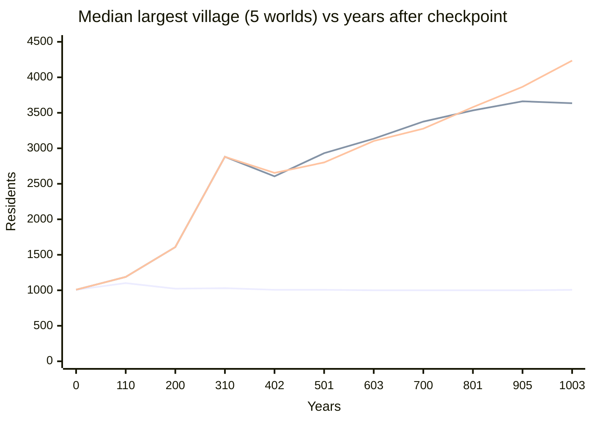

# Civic Governance: Matched Comparison Sweep Report

**Date:** 28 November 2026
**Branch:** `features/civic-governance` (PR #51, stacked on PR #49 `features/plough-elder-irrigation`)
**Tool:** `Tools/CivicGovernanceSweep` (`Program.cs`, `Summarize.py`)
**Spec:** [CivicGovernance.md](CivicGovernance.md) §5 Choice #11.E (M5 gate) and §6

> **Follow-up:** [The 2,000-year irrigation and trajectory audit](CivicIrrigationTrajectoryAudit.md) supersedes the permanent land-ceiling diagnosis and R1-first priority below. All five full arms pass 5,000 under the normal calendar; none does when turn duration is frozen after year 1,000. The harvest/recovery boundary is a demonstrated source of the calendar dependence. The original 1,000-year measurements below remain valid.

## 1. Question

PR #49 (Plough and irrigation) left Neolithic villages capped at about 1,000 residents by crowding and disease mortality. The civic governance system is designed to lift that cap in two stages:

- **Phase 1, crowding relief:** civic capital and Stewards reduce crowding mortality (`M_c`) and raise cohesion. Target: about 3,000 residents.
- **Phase 2, sanitation:** a watered sanitation stock, unlocked by the Tier 3B precedent, reduces disease mortality (`M_d`). Target: 5,000–10,000 residents.

This sweep tests both targets in normal AI play on generated worlds, with no fixtures. It also identifies what binds once each phase is active.

## 2. Method

| Item | Value |
| --- | --- |
| Worlds | Native 96x48, four players, `WorldGenerator`, seeds 11, 23, 47, 101, 1729 |
| Profile | `Assets/_Anthropocene/Resources/CivicGovernanceOpeningConfig.json` (PR #49 agricultural profile plus the `Civic` block) |
| History | Normal AI opening, then 600 organic years with `Civic == null` (identical in every arm) |
| Checkpoint | Plough and Irrigation knowledge granted to every society (the PR #49 ~1,000 regime), then saved |
| Arm horizon | 1,000 years from the checkpoint (96 smoothed-calendar turns, about 8–12 years each) |
| Overrides after checkpoint | None: no population, staffing, knowledge or civic-state edits (except the diagnostic arm) |
| Checks per arm | `TurnResolver.Invariants`, `CivicGovernance.ValidateInvariants`, deterministic two-replica continuation; reruns are bit-identical |

**Arms.** Each arm resumes the same checkpoint bytes. Only `SimulationConfig.Civic` differs.

| Arm | `Civic` | Purpose |
| --- | --- | --- |
| `off` | `null` | PR #49 behaviour (control) |
| `phase1` | enabled, `SanitationEnabled = false` | Crowding relief only |
| `full` | enabled, `SanitationEnabled = true` | Crowding relief plus sanitation |
| `full-3a` | as `full`, with Tier 3A granted as soon as a society holds Tier 2 | **Diagnostic counterfactual**, not organic play. It isolates whether Tier 3A accrual is the limit. |

**Reproduce:**

```
dotnet run -c Release --project Tools/CivicGovernanceSweep -- --years=1000 --arms=off,phase1,full,full-3a
python Tools/CivicGovernanceSweep/Summarize.py
```

The full run takes about 6 minutes on a 2-core VM. Checkpoints are cached in `TestResults/CivicGovernanceSweep/`.

## 3. Results

### 3.1 Headline

| Arm | Peak village, median / max | Largest village at end (median) | World population at end (5 worlds) | Villages > 2,000 / > 3,500 / > 5,000 at end | Mean civic / sanitation coverage | Mean turn ms |
| --- | --- | --- | --- | --- | --- | --- |
| off | 1,114 / 1,150 | 1,006 | 97,508 | 0 / 0 / 0 | – | 94 |
| phase1 | 3,800 / 3,845 | 3,635 | 221,576 (2.27x) | 60 / 5 / 0 | 0.81 / – | 112 |
| full | 4,363 / 4,683 | 4,236 | 243,611 (2.50x) | 62 / 18 / 0 | 0.79 / 0.52 | 116 |
| full-3a | 4,234 / 4,423 | 4,234 | 244,639 (2.51x) | 60 / 18 / 0 | 0.79 / 0.50 | 119 |

### 3.2 Per seed

| Seed | Villages at end (full) | Peak village off / phase1 / full | World population at end off / phase1 / full |
| --- | --- | --- | --- |
| 11 | 25 | 1,098 / 3,845 / 4,683 | 21,700 / 59,106 / 63,652 |
| 23 | 15 | 1,114 / 3,158 / 3,920 | 12,993 / 27,708 / 30,093 |
| 47 | 21 | 1,141 / 3,800 / 4,425 | 17,364 / 37,953 / 42,833 |
| 101 | 45 | 1,150 / 3,820 / 4,363 | 36,021 / 75,972 / 80,592 |
| 1729 | 12 | 1,067 / 3,016 / 3,988 | 9,430 / 20,837 / 26,441 |

Phase 1 and Phase 2 improve both the peak and the world population on **every** seed.

### 3.3 Trajectory: median largest village across the five worlds



Lines from bottom to top: `off`, `phase1`, `full`.

- **Years 0–310:** Tier 1 and Tier 2 civic organisation unlock organically, and the largest villages climb from ~1,000 to ~2,900 in about three centuries.
- **Around year 400:** the first Tier 3B precedents appear and the arms diverge.
- **By year 1,000:** `phase1` has plateaued near 3,600. `full` is still rising slowly, at about +400 per century.

| Years | 0 | 110 | 200 | 310 | 402 | 501 | 603 | 700 | 801 | 905 | 1003 |
| --- | --- | --- | --- | --- | --- | --- | --- | --- | --- | --- | --- |
| World population, off | 70,349 | 77,600 | 80,489 | 84,939 | 89,049 | 90,489 | 92,743 | 93,257 | 94,544 | 96,696 | 97,508 |
| World population, phase1 | 70,349 | 84,722 | 106,703 | 142,488 | 150,849 | 159,198 | 178,432 | 188,110 | 197,381 | 211,262 | 221,576 |
| World population, full | 70,349 | 84,722 | 106,703 | 142,488 | 151,877 | 159,253 | 183,482 | 191,898 | 202,675 | 222,138 | 243,611 |

### 3.4 Institutions at year 1,000 (full arm)

| Seed | Villages | Tier 1 / 2 / 3A / 3B | Mean C | Mean P | Egalitarian villages (P < −0.25): count, largest | Stratified villages (P > +0.25): count, largest |
| --- | --- | --- | --- | --- | --- | --- |
| 11 | 25 | 25 / 25 / 0 / 18 | 0.73 | −0.06 | 5, 4,161 | 0, – |
| 23 | 15 | 13 / 12 / 0 / 7 | 0.59 | −0.05 | 1, 1,160 | 0, – |
| 47 | 21 | 17 / 15 / 0 / 10 | 0.54 | +0.07 | 1, 2,479 | 2, 1,829 |
| 101 | 45 | 34 / 31 / 2 / 21 | 0.52 | +0.06 | 1, 2,075 | 3, 3,135 |
| 1729 | 12 | 10 / 9 / 0 / 7 | 0.58 | −0.13 | 2, 3,988 | 0, – |

Environment shapes the institutions: seeds 47 and 101 drift slightly Stratified, while 11, 23 and 1729 drift slightly Egalitarian. Most large villages still sit in the middle band (|P| ≤ 0.25).

### 3.5 Cost

The mean turn for the four-player world is 94 ms with civic off, 112 ms in `phase1` (+19%) and 116 ms in `full` (+23%). The worst single turn with civic on was 273 ms (seed 101, 45 villages). The per-seed ratio is stable, consistent with the designed O(villages × 7 local tiles) cost. The 1/16/80/320-tribe scaling benchmark has not been run.

## 4. Diagnosis

### 4.1 Phase 1 meets its target

On every seed, crowding relief takes the ~1,000 cap to 3,000–3,850. In the `full` arm, the largest villages reach civic coverage of 0.82–1.0 and `M_c` of 0.09–0.24.

### 4.2 Phase 2 breaks the disease wall but stops near 4,000–4,700

Tier 3B appears in 7–21 villages per world, and sanitation is fully watered wherever it is built (water ratio 1.0). The ~3,400 disease wall is broken, but no village reaches 5,000 within 1,000 years. Two factors are involved.

**(a) Tier 3A almost never unlocks organically (2 of 118 villages).** Its two practice drivers are almost zero in this profile:

| Seed | Tier-2 villages without 3A | Mean stored-food term | Mean trade term | Mean / max 3A experience (threshold 120) |
| --- | --- | --- | --- | --- |
| 11 | 25 | 0.005 | 0.0002 | 26 / 111 |
| 47 | 15 | 0.008 | 0.00005 | 30 / 94 |
| 101 | 29 | 0.001 | 0.0001 | 23 / 94 |

Food reserves are near zero (see 4.2b) and AI trade volume is negligible. Without 3A, complexity stays at the Tier-2 ceiling of 0.75 and `M_d` stays near 0.35. The spec's 5k–10k equilibria assume complexity near 1.0, with `M_d` 0.19–0.34.

**(b) Granting 3A does not help, because farmland binds first.** In `full-3a`, the largest villages reach C ≈ 0.97, `M_c` ≈ 0.08 and `M_d` ≈ 0.27, close to the design optimum. Yet peaks are unchanged (4,234 vs 4,363 median). Their final turn:

| Seed, arm | Residents | Farmed tiles | Irrigated fields | Farmers | Residents per farmed tile | Food produced / required | Reserves | Birth rate | Crowding + disease + exposure deaths |
| --- | --- | --- | --- | --- | --- | --- | --- | --- | --- |
| 11, off | 1,012 | 7 | 0 | 459 | 145 | – | – | – | – |
| 11, full | 4,236 | 7 | 0 | 3,387 | 605 | 135,591 / 133,927 | 0 | 0.034 | 0.033 |
| 101, full | 4,363 | 7 | 0 | 3,020 | 623 | 134,081 / 132,617 | 1,139 | 0.045 | 0.031 |
| 101, full | 3,968 | 8 | 0 | 3,280 | 496 | – | – | – | – |

The largest villages farm only their 7 footprint tiles (radius 1), with almost no irrigated fields, and 70–80% of residents work as Farmers. Food produced roughly equals food required and reserves are near zero. Because births are funded only from surplus, the birth rate falls to match mortality. These villages are at a **food/land equilibrium of about 600 residents per farmed tile**. That sits well below the ~7,600 demographic equilibrium their mitigation levels would allow.

### 4.3 Egalitarian vs Stratified

The spec predicts Stratified villages peak higher in Phase 2 and Egalitarian ones are cheaper at 1,000–4,000. The sweep does not settle the first claim:
- Over the whole run, the largest village ever classed Egalitarian (P < −0.25) reached 4,683 in `full` (seed 11). The largest Stratified one (P > +0.25) reached 3,263 (seed 101).
- In `phase1` the order reverses: Stratified 3,800 (seed 47) vs Egalitarian 3,630 (seed 11).
- At year 1,000 the five largest `full` villages all sit in or near the middle band (P from −0.44 to +0.24).

Because every large village is land-limited, the stratification bonus to `M_d` never becomes the binding factor. A matched policy arm is needed (R4).

## 5. Conclusions

1. **Phase 1 meets its target on every seed.** The civic system turns the PR #49 cap of about 1,000 into 3,000–3,850 cities and more than doubles world population. It costs about 20% more turn time.
2. **Phase 2 works as a mechanism but falls short of its population target in organic play.** It breaks the 3,400 disease wall to 3,900–4,700. The 5,000–10,000 range is reached only in the controlled fixture (headless Phase-2 gate: peak 6,592 on radius-2 farmland).
3. **The next wall is land and food logistics, not governance.** A Chalcolithic town of 5,000–10,000 needs food from beyond its own seven tiles. That was not in scope for this PR.

## 6. Recommendations

| # | Recommendation | Where | Notes |
| --- | --- | --- | --- |
| R1 | Hinterland or tribute food: let Tier 2+ (or 3A) centres draw food from satellite villages or expanded fields beyond radius 1 | New design (follows `Docs/HerdValuationHandoff.md` hinterland items) | Historically grounded: redistribution, temple and elite storage, Uruk-period hinterlands. Scales with active villages if kept as sparse claims. |
| R2 | Investigate why the AI builds almost no irrigated fields even with knowledge granted | PR #49 (`IrrigationEconomy`, DemandControl canal requests) | Irrigation should raise food per tile, which is exactly the binding factor. |
| R3 | Recalibrate Tier 3A drivers to the profile's observed low reserves and trade (trade enabled; optional goods storage off) | `CivicGovernance.Close` Tier 3A accrual; `Tier3APracticeThreshold` | For example, add a Steward-years or redistribution term, so 3A is reachable without large reserves or trade. Low priority until R1 or R2 lifts the food limit. |
| R4 | Re-run this sweep after R1/R2, adding a matched Egalitarian vs Stratified policy arm (`CivicFocus` orders) | `Tools/CivicGovernanceSweep` | Tests the spec's Phase-2 Stratified-peaks-higher claim. |
| R5 | Finish the rest of M5: the 80-tribe long run and the 1/16/80/320-tribe scaling benchmark | `Tools/CivicGovernanceSweep` | Turn-cost evidence beyond four players. |

## 7. Limitations

- One world size (96x48, four players) and one profile. Results are evidence for these seeds, not a general claim.
- The organic history before the checkpoint runs without civic institutions. All arms start with zero civic state from a PR #49 baseline, rather than co-evolving from the opening.
- `full-3a` edits precedents during play. It is a diagnostic, not a gameplay outcome.
- `full` populations were still rising slowly at year 1,000, so longer horizons may exceed 4,700. The food balance suggests they will not reach 5,000 without more land.
- The Unity UI was not exercised.
