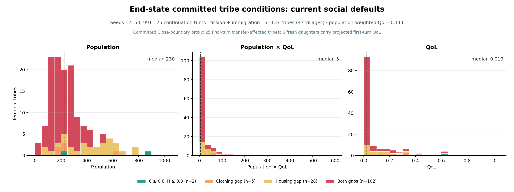

# Unified social relocation validation v0.2

Status: the shared architecture, finite-input accounting, deterministic replay and
population-transfer conservation pass. The identified DemandControl priority,
shelter-route, field-bound, same-turn tool-closure and reserve/feedstock double-
spend defects are repaired and covered by regressions. Native settlements no
longer exhibit the original forecast-collapse signature, but the matched recovery
gate still lacks sustained balanced protection. Cross-settlement ecological-
contention forecasting, learned-policy comparison and promotion of the Physical-v1
social law remain uncertified. **NO-GO for a fresh MLP training bank.**

**Evidence provenance.** The 25-turn social ablations, cooldown/site sweeps,
histograms, daughter audit and scale tables below were pinned before the current
DemandControl repairs. They remain historical evidence about the social
mechanisms, not current post-repair balance measurements. The section titled
"Current post-repair recovery result" is the current causal run. The later
"pre-repair diagnosis" is retained to show how the repair targets were selected;
values from the two generations must not be compared as one matched experiment.

## Aggregate game experience first

The sampled game does not look like a demographic death loop. It looks like a
rapidly growing population whose goods economy does not keep clothing and shelter
abreast of growth, while fission repeatedly turns that population into more small
settlements.

In the historical pre-fix ablation, three identical saved post-opening boundaries
(seeds 17, 53 and 991) begin with
24 camps and 2,653 people. After 25 continuation turns per seed:

| Social systems | Camps | Population | Fissions | Immigration flows / people | Rapid pair returns |
| --- | ---: | ---: | ---: | ---: | ---: |
| Neither | 24 | 10,716 | 0 | 0 / 0 | 0 |
| Fission only | 165 | 42,659 | 141 | 0 / 0 | 0 |
| Immigration only | 24 | 10,716 | 0 | 0 / 0 | 0 |
| Both | 145 | 39,795 | 121 | 101 / 1,295 | 6 |

No observed daughter or immigration receiver is extinct at the one- or three-turn
follow-up. Gross births and cause-specific deaths are both large, but births remain
larger in aggregate. A genuinely infeasible controlled settlement still declines
for explicit exposure and starvation causes, so this result is not a survival
guarantee.

The end state remains materially poor. Of 145 living tribes, none has both
clothing and housing coverage at least 0.8, 9 have only a clothing gap, 35 only a
housing gap, and 101 have both gaps. Total population × QoL is 4,754.024 and
population-weighted QoL is 0.119463. The QoL formula was not changed.



Immigration is not the source of the settlement network. It commits no move in the
immigration-only branch. Fission alone creates 141 new camps; the combined branch
creates 121 because immigration participants sit out same-turn fission and then
change later trajectories. In the combined run, the largest absolute migrant
source is the both-gaps category because it supplies the largest denominator.
Non-village flow counts per source-capable camp-turn are 0/60 for a clothing gap,
15/220 for a housing gap and 71/1,353 for both gaps. Village counts are 1/15,
3/79 and 11/170 respectively. Neither of the two adequate source-capable camp-turns
sends a cohort. The small village clothing-only denominator has the highest
observed rate, so the evidence
does not support a rule that the composite both-gaps state alone drives movement.


The first demonstrated native blocker was in the automatic economy controller,
not immigration. DemandControl promoted the complete consumption + reserve +
maximum-birth food target into its pre-arbitration `Survival` workforce, an
assumption that predated PhysicalMortalityV1. Its mixed shelter route, unbounded
field request and a circular same-turn tool forecast amplified the protection
backlog. Those defects are now repaired without changing experienced QoL,
demography or social thresholds. The remaining current blocker is described in
the post-repair recovery section below.

### Daughter maturation control (historical pre-fix sweep)

The new Physical-v1 daughter cooldown is a narrow timing guard. A matched sweep
from the same three boundaries produced:

| Additional blocked turns | Fissions | Recursive daughter fissions (age 1/2/3/older) | Fission / immigration-outflow blocks | Daughter outflow events age 1/2 | Camps | Population | Viable settlements | Pop-weighted QoL |
| ---: | ---: | ---: | ---: | ---: | ---: | ---: | ---: | ---: |
| 0 | 123 | 73 (7/6/4/56) | 0 / 0 | 2 / 6 | 147 | 39,479 | 0 | 0.124 |
| **1 (shipped)** | **121** | **71 (0/10/3/58)** | **105 / 118** | **0 / 6** | **145** | **39,795** | **0** | **0.119** |
| 2 | 114 | 64 (0/0/7/57) | 202 / 223 | 0 / 0 | 138 | 39,193 | 0 | 0.126 |

The default eliminates one-turn daughter recursion and one-turn daughter
immigration outflow exactly, including across save/load. The zero-cooldown control
has two age-one outflows moving 21 people; the default has none, while still
allowing 13 age-one inflows. The default configured group minimum is four, but the
10 percent cap and 12-person source floor make 40 residents the smallest effective
source. The two-turn alternative is not promoted: it has seven fewer fissions but
still no viable endpoint. No QoL, mortality, reward, immigration utility or
fission-threshold calibration changed.

### Forecaster correction and bounded site-selection control (historical pre-fix sweep)

The requested Astra review found that fission already gives projected food the
first two historical destination keys: capped obtainable support, then uncapped
support, before distance and tile ID. It also identified a concrete representation
defect: the new-site forecast reconstructed raw supply from capped support, lost
aquatic type and could apply gathering accessibility twice.

That defect is corrected without changing utility, thresholds, QoL, mortality or
reward. New-site capacity now carries uncapped repeatable land, aquatic and
managed-land food separately; actual transferred workforce and accessibility are
applied once; herd forage/water remain separate; and reports expose uncapped
renewable-food ratio plus typed production. Focused tests cover rich-site headroom,
aquatic non-fungibility, exact workforce use and herd-coverage diagnostics. A
bounded forecast of carried-herd receipts and competition for land food remains a
robustness follow-up; the old conversion of poor pasture into fewer human calories
is not restored.

The historical `EcologicalSupport` selector remains the default. Two opt-in modes
evaluate at most the first four ecologically ranked sites through the unchanged
shared acceptance gate and then select by accepted renewable food or aggregate
welfare. In the matched 25-turn sweep, both alternatives produce 127 fissions,
151 camps, 42,307 people, 13 negative-net daughters and zero viable settlements,
versus 121 / 145 / 39,795 / 10 / zero for the historical control. They improve
population-weighted QoL from 0.119 to 0.151 but do so by creating more settlements;
neither is promoted. No numerical food bonus or survival weight was introduced.

### Why daughter economies do not balance (historical pre-fix audit)

The opt-in real-economy daughter audit compares site yield with the conversion of
labor and capital into services. It compares fission-only and fission-plus-
immigration trajectories from the same three boundaries and follows daughters for
up to eight turns. It is an observational decomposition, not a causal intervention.
Its pre-decision allocator replay omits pending trade views and therefore identifies
candidate bottlenecks rather than attributing the executed turn.

Across daughter ages one through three, fission-only settlements produce 95.5% of
food need and realize 97.1% nutritional satisfaction. With immigration, those
figures are 96.9% and 97.5%. Food is therefore slightly tight, but it is not the
coverage that collapses: mean clothing is 0.210 / 0.206 and housing is 0.043 /
0.040. The dominant distinction is **calorie viability versus economic surplus**.

At founding, a daughter receives proportional portable stores and workforce but
zero fixed housing and zero site-bound field capital; transferred farmers become
gatherers because their fields stay with the parent. During ages one through three:

- the no-pending-trade counterfactual assigns 73–84% of the planning population
  to food gathering, 7–22% to farming, about 0.5% to herding and 3.1% to
  manufacturing on average;
- any clothing or shelter output occurs in only 31.7% of fission-only and 32.5% of
  combined daughter-camp turns;
- those counterfactual replays classify labor rationing and integer staffing as the common
  clothing/shelter blockers, while raw-material shortage is rare; and
- mean population reaches 1.91× founding size by age three, while fixed shelter
  covers only about 2–3% of residents across the early window.

The later isolated controls resolve this working diagnosis: the sites are calorie-
viable, while DemandControl reserves too much labor for future food before it
arbitrates current protective services. A daughter must also replace fixed housing
that correctly stayed with its parent. Immigration changes the early service
figures little, and the same deficit exists with both social systems disabled, so
neither immigration nor fission initiates the economic imbalance.

### Current post-repair recovery result

The current run advances seeds 17, 53 and 991 to the first native fission Close
boundary and follows the resulting five matched parent/daughter pairs for 20
turns with later fission and immigration disabled. All ten tracked settlements
remain alive and grow. Low QoL does not prohibit births: parents end at 3.939x
their boundary population and daughters at 17.917x. One path of each kind becomes
fully served briefly, but none remains at `F,C,H >= 0.8` for three turns.

| Cohort | Terminal population / boundary | Terminal F/C/H | Terminal QoL | Mean F/C/H, ages 12-20 | Mean QoL |
| --- | ---: | ---: | ---: | ---: | ---: |
| Parent | 3.939x | 0.919 / 0.186 / 0.637 | 0.539 | 0.871 / 0.101 / 0.646 | 0.497 |
| Daughter | 17.917x | 0.909 / 0.122 / 0.830 | 0.504 | 0.891 / 0.085 / 0.758 | 0.448 |

Housing is no longer the primary failure. The bounded alternate shelter route
and Housing Material ceiling repair raise late-window mean housing to 0.646 for
parents and 0.758 for daughters. The remaining service deficit is clothing, and
its cause is explicit rather than a QoL gate: current clothing is plant-feedstock
bound in 40 of 45 parent camp-turns and 41 of 45 daughter camp-turns while mean
nutrition is 0.871 and 0.891.

One allocator-to-resolver defect was a circular same-turn tool estimate.
For example, one pre-fix camp granted 452 Cloth but forecast and made only 41.801.
The allocation had budgeted 233.535 Regular Tools, while the forecast requested
only 3.223 because `ToolReplacementDemands` sized useful textile work from opening
Plant Food and could not see the feedstock the same plan would gather. A
ceiling-bearing DemandControl order now uses its already validated tool allocation
as the forecast's internal tool demand; Legacy/Value orders retain their existing
replacement calculation. The zero-opening-feedstock regression makes tools first,
then Cloth, and bounds both by their Elder ceilings.

The second defect was in the food envelope. DemandControl placed food-reserve
refill and clothing-buffer work in Recovery, but its normal Plant Food envelope
subtracted meals and omitted the protected operating reserve. It could therefore
sell the same finite harvest once to reserve refill and again to reserve-clothing
feedstock. Resolution correctly paid the reserve first, making less Cloth than the
Elder promised. DemandControl now closes normal manufacturing behind the same
attainable reserve target used by resolution; current clothing retains its
authorized meals-only exception. The compatibility Legacy/Value path is unchanged.
A focused full-turn fixture starts with exactly meals plus reserve and proves that
current clothing is made, reserve clothing is rejected as Plant-feedstock-bound,
and forecast equals authoritative output.

After the food-ledger and tool-demand repairs, the local Cloth ceilings close to the
local forecast. Parent Cloth then closes at 1.000 forecast/actual over ages 12-20. Daughter Cloth now
realizes 0.893 and shelter 0.868. The traced material daughter misses are current-
clothing claims whose authoritative Plant receipts fall below the camp-local plan,
consistent with cross-settlement ecological contention after local preparation:
for example, one plan admits 144.322 Plant Food/Cloth, but only 35.157 remains
beyond meals in the authoritative shared harvest. A claim-to-receipt replay is
still required to close that attribution. This is the remaining forecast-
robustness gap, not missing Weaver labor, a QoL birth veto, a mortality calculation
or a tool-bootstrap failure.

The shelter fallback now also settles opening Animal Fabric and Housing Material
against the actual grant before constructing an alternate route or entering a lower
service class. A focused no-new-feedstock fixture proves that a Recovery backlog
cannot reserve fabric ahead of Continuity replacement; partial-grant fixtures prove
that unused opening intermediates are released and never counted twice.

More importantly, forecast error is not the cause of the low mean clothing state.
The local allocator itself grants only 0.118 current-clothing units per daughter
resident-turn in the late window, of which the resolver realizes 0.106, and grants
no clothing-buffer recovery; 41 of 45 daughter camp-turns are explicitly Plant-
feedstock-bound. Expected local supply is 79.722 per resident-turn against 89.184
meals, so most turns have no plant surplus after current nutrition. A 4x Weaver-
rate control leaves terminal daughter clothing unchanged within three decimals.
Production speed is therefore not the binding repair.

Field development is also finite now: requests are capped by the post-Survival
workforce and take about 3.8 parent and 5.9 daughter ladder steps per camp-turn,
instead of tens of steps and millions of requested workers per resident. It
requests/grants 0.403/0.332 parent and 0.467/0.403 daughter workers per resident in
the late window. Disabling it lowers clothing and terminal population in all three
seeds, so deleting field investment is falsified as a repair. The next economic
test must compare its finite marginal
return with the foregone gatherer return and close the forecast against competing
ecological claims; it must not add free food or tune recipe multipliers first.

The current conclusion is narrower than a GO: the systems-level death loop is not
observed, and the repaired local production-closure defects are not observed in
these native paths. Rapidly growing settlements remain physically food/feedstock
constrained and do not demonstrate sustained balanced protection. The unresolved
planner question is how to value finite field development against immediate
gathering and how to quote supply under shared ecological contention. This is not
evidence that immigration manufactures the failure, and it is not evidence for a
global clothing or housing multiplier.

### Isolated recovery and the upstream economic defect (pre-repair diagnosis)

This retained pre-repair diagnostic advanced each seed to its first native
fission, saves that exact Close boundary once, and replays it for 20 turns. Both
later fission and immigration are disabled in isolated branches. The first fission
occurs on turn 9 in all three seeds and yields nine matched parent/daughter pairs.
All 18 settlements remain alive and grow, but none reaches `F,C,H >= 0.8`:

| Cohort | Population / boundary | Terminal F/C/H | Terminal QoL | Mean F/C/H, ages 12-20 |
| --- | ---: | ---: | ---: | ---: |
| Parent | 3.592x | 0.935 / 0.306 / 0.267 | 0.181 | 0.938 / 0.259 / 0.218 |
| Daughter | 15.598x | 0.949 / 0.579 / 0.261 | 0.181 | 0.957 / 0.409 / 0.153 |

This is a low-welfare, high-turnover growth equilibrium, not a death loop. Gross
births remain high and the explicit exposure, crowding, disease and starvation
ledgers account for deaths. Daughters are hit harder because fixed fields and
fixed Housing correctly stay with the parent, but parents fail the same recovery
criterion. At founding, both cohorts are already protection-poor; the daughter
has no copied fixed capital and must bootstrap from its conserved portable share.

#### Demonstrated first repair target: an obsolete food-priority assumption

DemandControl was introduced on 4 October 2026; PhysicalMortalityV1 was integrated
on 15 October. Its original survival calculation still reads
`CampProductionDemand.Biological`, which is `PlanningFoodDemand`: current meal
income + reserve refill + food for the maximum demographic rate. Before the
physical refactor, `QoLMortality.MaximumRate` became zero below QoL 0.746 (and after
any deficit turn). The sampled parents and daughters begin at mean QoL 0.452 and
0.533. Once QoL mortality and DemandControl became defaults together, that
obsolete birth prohibition masked the growth-priority error in low-welfare
settlements.

PhysicalMortalityV1 correctly changed that maximum to the 0.045 birth-only
envelope, independent of QoL. DemandControl did not change its service
classification. It therefore reserves workers for maximum births before it
arbitrates clothing, housing or reserve recovery. During ages 12-20, the food
buckets and implied food-gatherer shares are:

| Cohort | Current / reserve / max-birth food per resident-turn | Gatherer share: current / +reserve / +growth / all |
| --- | ---: | ---: |
| Parent | 99.706 / 94.077 / 62.099 | 0.442 / 0.489 / 0.535 / 0.537 |
| Daughter | 85.330 / 58.579 / 53.161 | 0.436 / 0.470 / 0.578 / 0.593 |

Thus maximum-birth provisioning, not current subsistence, is the dominant extra
top-priority burden in daughters. Reserve refill also belongs to Recovery rather
than Survival. This violates the economic-control priority contract even though
the demographic law itself is correct.

A matched diagnostic removes only maximum-growth food from the pre-arbitration
Survival target; it does not change `BaseBirthRate`, food stocks, mortality,
recipes, fission or immigration, and the physical resolver still funds births
from actual remaining food. Daughter mean clothing/housing rises from
`0.409 / 0.153` to `0.628 / 0.220`; parent values rise from `0.259 / 0.218` to
`0.390 / 0.284`. Terminal populations increase rather than being suppressed. This
is direct causal evidence that the planner's priority integration contributes
upstream of the protection imbalance. It is the first repair target, not a claim
that every remaining service failure has one exclusive cause.

#### Secondary planner defects and ruled-out alternatives

Three additional defects amplify the result:

1. The aggregate bundle check formerly let unrelated tent Animal Food borrow the
   current-clothing before-reserve exception. In 13 of 14 traced tent turns it
   allocated ordinary Animal Food past the normal envelope; 1,171.562 units were
   allocated, while `PlanGrowth` admitted 3.998 to its manufacturing budget and
   production records consumed 113.166. These are different stages, not a closed
   debit ledger. The focused allocator regression now proves that such a tent grant
   is rejected; the matched trajectory reports allocation, growth-budget admission
   and actual consumption separately. Full source-to-service closure remains a
   repair target.
2. `MaterialEconomy.Forecast` applied DemandControl's Housing Material ceiling and
   then overwrote it with the export limit. The forecast now takes the minimum;
   a direct ceiling regression covers the failure.
3. Dual-capability camps hard-route decay replacement to fixed Housing and the
   remaining shelter backlog to Light Housing, with no fallback when Animal Fabric
   is unavailable. A matched fixed-route control raises daughter shelter forecast
   realization from 81.4% to 88.2%, mean housing from 0.153 to 0.257 and terminal
   housing by 0.142. This is a material amplifier, but seed 17 has no dual-route
   tracked camp and still fails, so it is not the universal root.

DemandControl also requests 8.76 million parent and 2.04 million daughter field-
expansion persons per resident-turn, traversing about 90 and 67 positive ladder
steps per camp-turn down to effectively zero marginal score. Arbitration grants
only 0.231 and 0.216 persons per resident because Development comes last. Disabling
field development does not restore viability, so it is not the initiating failure;
the unbounded request is nevertheless a separate strategy defect and it distorts
the longer-run capital/population mix.

Integer repair is likewise a symptom, not the first cause: it runs in 85.2% of
parent and 96.3% of daughter camp-turns, but the final emergency trim never runs.
Removing field development collapses repair frequency without restoring balanced
services. Finally, 1.5x, 2x and 4x Weaver/Builder rate controls all fail; at 4x,
daughter terminal F/C/H is only `0.960 / 0.429 / 0.262`. Recipe speed is not the
binding first repair.

The stable-population/fixed-shelter branch is a semantic stress diagnostic only:
it switches to `LegacyQoLNetGrowth` with zero annual growth. It is not same-physics
causal evidence for PhysicalMortalityV1 and is excluded from the attribution above.

#### Identifiable repair sequence and current disposition

No global production multiplier is justified. The bounded repair sequence and
its current disposition are:

1. **Completed.** Split the food controller by service class. Survival funds current meals and
   their feasible dependencies. Current protective-goods input remains Continuity;
   reserve refill is Recovery; maximum-birth provisioning and capacity expansion
   are Development only when explicitly authorized. Births remain the physical
   consequence of actual food and the 0.045 fertility law—there is no QoL gate,
   population floor or demographic bonus.
2. **Completed for local allocation, reserve accounting and same-turn tool
   closure; cross-settlement claim competition remains open.** In the same bounded
   forecast/plan, debit one shared finite typed food/feedstock ledger after each
   admitted class instead of granting every class against one no-contention supply
   envelope. Do not rerun ecology, food or production forecasts per class. Assert
   request → grant → integer staff → finite input → intermediate → final output →
   paid service. The reserve/feedstock regression now closes exactly and native
   daughter Cloth realizes 89.3% of forecast in the late window; the remaining
   material misses are consistent with authoritative shared-tile contention that
   the camp-local quote does not yet include, pending claim-to-receipt closure.
3. **Completed.** Represent shelter as one non-duplicated service with a deterministic primary
   route and one bounded fallback for still-unserved people. Opening intermediates
   follow actual grants, so a Recovery route cannot reserve stock ahead of a
   Continuity fallback and partial requests return unused stock. Preserve existing
   route calibration and physical inputs; do not add a survival weight.
4. **Completed for the finite workforce bound.** Replace the all-positive-steps field request with an explicit Elder directive
   and a finite marginal-productivity/worker-year budget. Preserve the resolver's
   gatherer bridge and useful field investment; the no-field control shows that
   simply disabling development is not a repair.
5. **Completed for isolated post-fission continuations and still NO-GO.** These
   continuations disable later fission and immigration after the native boundary;
   they are not the pending whole-world no-social branch. Only a finite, fully
   staffed bundle that still misses its service target can justify per-capita
   production tuning.

## Scope and reproduction

The branch extends reviewed daughter-cooldown commit
`472a22ed0159bb36d583afca3a9ec045335bf465`. The tracked contract copy is
byte-identical to the supplied attachment. Representative commands are:

```sh
dotnet build Tools/Headless/Anthropocene.Headless.csproj -c Release
dotnet run --no-build -c Release --project Tools/Headless/Anthropocene.Headless.csproj -- --social-relocation-only
dotnet run --no-build -c Release --project Tools/Headless/Anthropocene.Headless.csproj -- --immigration-only
dotnet run --no-build -c Release --project Tools/Headless/Anthropocene.Headless.csproj -- --fission-only
dotnet run --no-build -c Release --project Tools/Headless/Anthropocene.Headless.csproj -- --social-relocation-native=3
dotnet run --no-build -c Release --project Tools/Headless/Anthropocene.Headless.csproj -- --demography-regression
dotnet run --no-build -c Release --project Tools/Headless/Anthropocene.Headless.csproj -- --demography-social-ablation=25
dotnet run --no-build -c Release --project Tools/Headless/Anthropocene.Headless.csproj -- --demography-immigration-sweep=25
dotnet run --no-build -c Release --project Tools/Headless/Anthropocene.Headless.csproj -- --demography-fission-cooldown-sweep=25
dotnet run --no-build -c Release --project Tools/Headless/Anthropocene.Headless.csproj -- --demography-fission-site-sweep=25
dotnet run --no-build -c Release --project Tools/Headless/Anthropocene.Headless.csproj -- --demography-daughter-economy=25
dotnet run --no-build -c Release --project Tools/Headless/Anthropocene.Headless.csproj -- --demography-fission-recovery=20
dotnet run --no-build -c Release --project Tools/Headless/Anthropocene.Headless.csproj -- --demography-qol-histogram=25
dotnet run --no-build -c Release --project Tools/Headless/Anthropocene.Headless.csproj -- --social-scale=8,25
dotnet run --no-build -c Release --project Tools/Headless/Anthropocene.Headless.csproj -- --social-scale=80,0
dotnet run --no-build -c Release --project Tools/Headless/Anthropocene.Headless.csproj -- --social-scale=320,0
```

Pipe the histogram rows to `Tools/Headless/Plot-DemographyQoLHistogram.py` to
reproduce both tracked figures.

Focused final counts include 154 DemandControl assertions, including food-class,
typed-feedstock, reserve/feedstock closure, grant-aware shelter-fallback stock,
partial intermediate reservations, Housing Material ceiling and same-turn tool-
closure coverage. The current isolated recovery/
productivity diagnostic passes 51,594 assertions. Earlier focused counts are 70 shared-relocation, 384
immigration, 673 fission, 37 native matched-continuation and 83 death-spiral
assertions. The matched
three-seed ablation passes 18,492 assertions; the ten-row immigration sweep passes
68,917; the three-row daughter-cooldown sweep passes 20,537; the three-row site-
selection sweep passes 21,107; the terminal histogram audit passes 10,829; the
daughter-economy audit passes 2,643. The current rebuild has zero errors and only
the pre-existing `SharedAllocation.CaptureLast` `CS0649` warning; the current full
fixed/replay suite exits zero.
Its runtime and peak memory were not sampled. The earlier pre-fix run took 61.0
seconds with 1,916 MiB peak working set on this host. The current-contract checker
passes 82 JSON/API values, 17 test claims and all document links.

## Architecture, finite inputs and compatibility

The focused checks establish:

- the exact mover, source, incumbent and aggregate equations, with physical
  mortality risk separate from forecast experienced QoL and no net-rate sign veto;
- birth-only person-year service ceilings, finite typed food, finite raw material
  stocks/sources, one shared generalist extraction pool and technology-qualified
  specialist extraction;
- uncapped, typed repeatable land/aquatic/managed food for new-site forecasts,
  with actual transferred workforce/accessibility applied once and herd forage and
  water kept separate from human food;
- source/daughter herd capacity scaled by the retained herd fraction, with a
  zero-herd control and no duplicated provisions, shelter or expectation reset;
- actual workforce-role transfer, opportunity-worker reservation and no worker
  simultaneously producing in an ordinary role and a future opportunity role;
- zero, funded, unfunded, missing-tool, missing-input, filled and wrong-skill test
  providers, one job per worker and canonical declining reservations;
- nonmonotone group-size handling and exact final simultaneous immigration
  revalidation, including a camp that sends frozen residents while receiving a
  different cohort in the same Close pass; endpoint work is pinned by an accepted
  chain, an eight-source fan-in and a cascading rejection with only incident retry;
- neutral-provider parity, scalar/parallel replay, save round trips and exact
  population, inventory, typed-food, herd, workforce and fractional-ledger
  conservation; and
- lazy capacity allocation plus a provably permissive physical fission bound. It
  uses the exact source envelope and optimistic full-service daughter, not
  historical F/C/H/W; `FissionSearchFraction` lowers only the valid upper-bound
  request threshold. Identical physical states with different last-turn
  satisfaction take the same search/decision path, including newly depleted
  settlements.

`ForwardUtility`, `Fission.QoLModel.ForwardAt` and the old largest-remainder legacy
semantics remain the exact decision path for `LegacyQoLNetGrowth`. An absent saved
demographic selector still loads that legacy model. Existing saves that already
select `PhysicalMortalityV1` will use the unified law on this feature branch because
no second serialized social-law selector was introduced. That is an intentional
unmerged behavior change, not backward-decision parity, and must be approved before
promotion.

`Camp.QoL`, its food/water/clothing/housing/expectation/cohesion calculation, the
population-weighted Elder reward and the RL observation schema are unchanged.
Settlement-local and lineage-wide welfare remain separate diagnostics.

## Native same-boundary outcomes (historical pre-fix ablation)

| Variant | Camps | Population | Fissions | Migrations / people | Mean terminal F/C/H | Pop-weighted local QoL |
| --- | ---: | ---: | ---: | ---: | ---: | ---: |
| Neither | 24 → 24 | 2,653 → 10,716 | 0 | 0 / 0 | 0.955 / 0.302 / 0.314 | 0.195 |
| Fission only | 24 → 165 | 2,653 → 42,659 | 141 | 0 / 0 | 0.935 / 0.259 / 0.132 | 0.127 |
| Immigration only | 24 → 24 | 2,653 → 10,716 | 0 | 0 / 0 | 0.955 / 0.302 / 0.314 | 0.195 |
| Both | 24 → 145 | 2,653 → 39,795 | 121 | 101 / 1,295 | 0.942 / 0.301 / 0.119 | 0.119 |

Worst continuous demographic conservation error is `1.14e-13`; every turn also
closes the integer population and gross birth/death ledgers. Twenty-six accepted
immigration destinations have higher forecast QoL and worse forecast mortality
when destination X1 is compared with the mover's source X0 on both axes,
confirming that mortality is visible without becoming a categorical veto.

The follow-up diagnostics remain cautionary rather than causal proof. Of 121
daughters, 118 are observed at age one and 112 at age three, with no extinction;
the age-three survivors average `-0.227` QoL and `-0.207` clothing coverage
relative to their event boundary, while their population averages 1.922 times the
founding cohort. Of 101 receivers, 93 are observed at age one and 80 at age three,
with no extinction; the age-three survivors average `-0.115` QoL, `-0.135`
clothing coverage and `+7.194` deficit years. No daughter or receiver is
fully healthy at the recorded event boundary or age three. Growth, subsequent
shocks and further transfers confound those raw deltas, so they justify targeted
matched tests rather than a claim that immigration caused the decline.

## Accepted, suppressed and forced continuation

The causal harness finds a real seed-17 boundary after two ordinary preparation
turns and isolates a 7-person immigration from camp 59 to camp 19. The accepted
flow records mover/source/incumbent/aggregate changes of
`+0.200813 / +0.002866 / -0.000822 / +0.006067`, destination forecast QoL 0.180,
F/C/H `0.363 / 0.000 / 1.000`, mortality risk 0.427 and stability zero.

An independently forced transfer has the same endpoint workforce, inventory,
typed food, demographic ledgers, migration memory and contact chronology as the
accepted branch. After three real heuristic/economy/ecology/demography turns,
accepted and forced transfer states remain identical. The sum across the three
follow-up endpoints of world `population × QoL`, accepted minus suppressed, is
`+0.957888`. This is explicitly an endpoint-welfare proxy, not the contract's
integrated person-year welfare. Age zero is reported only as a boundary proxy and
is excluded from that sum.
This case supports the transaction implementation; it does not certify all
receivers or fission daughters.

The 20%, 40% and delayed-40% branches are explicitly compound external shocks to
production, local stocks/ecology, capital, housing and herds on unique affected
tiles. They run the real economy with no correction resources. They are not a
claim that the forecast itself missed each input by exactly 20% or 40%, and they do
not yet provide a conservative admission rescore. Broader positive- and
zero-stability immigration cases plus matched fission cases remain required.

## Hysteresis calibration sweep (historical pre-fix)

The ten-row matched sweep leaves the QoL function, physical demography and fission
coefficients unchanged. With hysteresis disabled, 113 flows move 1,501 people and
produce 16 rapid pair returns. The current three-turn/0.10 penalty has 101 flows,
1,295 people and six returns. Raising only the penalty to 0.20 yields 100 flows,
1,264 people and the same six returns. A 0.30 penalty or five-turn/0.20 combination
has 95 / 1,183 / three, but neither improves age-three receiver QoL (`-0.116`
versus `-0.115`) or demonstrates causal welfare benefit.

Thus the existing hysteresis materially mitigates oscillation, but no alternative
is promoted. No immigration threshold, cap, cooldown or penalty changed. Arrival
population remains a Close-boundary transfer and first enters the real economy/demographic
calculation on the following turn.

## Recoverable distress and death-spiral gates

The physical-demography regression remains green:

- temporary clothing/housing loss and temporary food loss resume positive growth
  after service restoration;
- repeated infeasible loss declines for attributable exposure and starvation;
- deaths, emigration and fission reconcile separately, with social events conserved
  as transfers rather than mortality; and
- the native Elder rebuilds specialist assignments and real clothing/housing from
  remaining people, tools and finite raw resources, reaching three sustained
  served turns with first sustained recovery at turn 8.

There are no population floors, free resources, automatic manufacturing or
demographic bonuses. A learned-Elder runtime/model artifact is not present, so a
matched native-versus-learned shock comparison remains unavailable.

## Performance versus the pinned commit (historical pre-fix)

`SocialScaleBenchmark` is the same source compiled at the pinned commit and on
this branch. It measures the actual AI/prepare/resolve path in Release with seed
1729 and four workers. Short runs include JIT and host noise, and fission causes
the branches to diverge in camp count; these are scale observations, not a
cycle-exact microbenchmark.

| Scale | Pinned turn p50/p95 ms | Unified turn p50/p95 ms | Pinned alloc p50/p95 MiB | Unified alloc p50/p95 MiB | Unified social p50/p95 ms |
| --- | ---: | ---: | ---: | ---: | ---: |
| 8 starts, opening | 36.1 / 279.3 | 65.7 / 255.4 | 3.06 / 6.41 | 4.52 / 7.58 | 15.2 / 44.8 |
| 80 starts, opening | 431.6 / 500.8 | 488.3 / 676.9 | 63.99 / 102.02 | 77.24 / 121.25 | 66.3 / 81.4 |
| 320 starts, opening | 1,066.3 / 1,208.8 | 1,341.9 / 1,634.3 | 265.38 / 433.54 | 316.52 / 506.26 | 158.0 / 378.6 |
| 8 starts + 25 turns | 175.4 / 295.3 | 139.2 / 324.6 | 18.98 / 50.52 | 22.87 / 56.91 | 49.3 / 170.2 |

The safe fission bound deliberately builds physical baselines instead of using
historical coverage. The 320 run records 4,716 forecasts, 3,384 capacity builds
and 2,537 hits; its only active joint-immigration turn uses one batch, two flow
evaluations and eight endpoint builds. The mature run records 5,971 forecasts,
1,200 builds and 9,911 hits (0.892 hit share), with 48 flow evaluations and 191
endpoint builds across 24 joint batches. No dependency retry occurs in those
low-flow samples; the focused chain/fan-in/cascade tests exercise it directly.

Whole-turn 320 p95 is 35% above the pinned sample and allocation p95 is 16.8%
higher. The behaviorally divergent mature run ends with 44 rather than 88 camps;
its p95 is 9.9% higher. The 80 sample has a 35% higher p95, and
these short samples are not warmed repeated-boundary certification. They are
sufficient to fail, not pass, the throughput gate. The local scaling defect found
in review is fixed, but performance is **NO-GO for MLP throughput**. The next
optimization target is forecast-view/material-summary allocation and safe baseline
reuse, not a return to historical QoL coverage.

## GO/NO-GO matrix

| Gate | Result | Evidence / remaining work |
| --- | --- | --- |
| Conservation and legacy compatibility | PASS / scoped | Exact physical transfers and legacy selector path pass; existing Physical-v1 saves deliberately adopt the feature law |
| QoL and RL objective preservation | PASS | QoL calculation, reward and observation schema unchanged; local and lineage welfare separate |
| Shared physical architecture | PASS | One evaluator for immigration/crowding/distress; finite service/material inputs; no mortality-from-QoL or net-rate veto |
| Future opportunity accountability | PASS in injected fixtures | Neutral parity plus funded/false/filled/wrong-skill/reservation/nonmonotone coverage; no live jobs |
| Native conservation and recoverable distress | PARTIAL / NO-GO | Same-boundary conservation and cause ledgers pass. All ten current isolated parent/daughter paths survive and grow; one path of each kind becomes healthy briefly, but none sustains balanced protection for three turns |
| Healthy/saturated/distress social balance | NO-GO | Food classes, reserve accounting, shelter fallback, field bounds and internal tool closure are repaired, but current clothing remains physically Plant-Food-bound and the post-repair full social sweep has not been rerun |
| Native causal cases | PARTIAL | One immigration accepted/suppressed/forced case is positive and exact; fission and broader receiver classes missing |
| Forecast robustness | PARTIAL | Local reserve/feedstock and tool closure pass; two material daughter Cloth misses are consistent with shared-tile ecological contention, pending a claim-to-receipt replay. Herd forage/water are diagnostic only, and pastoral stock competition plus lower-bound admission rescores remain open |
| Site selection | NO-GO for promotion | Bounded accepted-site food/aggregate controls create 127 fissions and zero viable endpoints; historical ordering remains default |
| Oscillation | PASS for current default; calibration open | Existing hysteresis cuts rapid returns 16→6; alternatives lack causal/held-out welfare justification |
| Performance | NO-GO for MLP | Endpoint-local reconciliation passes work-counter tests, but 320/mature p95 and allocation overhead fail promotion |
| Learned-vs-native comparison | NOT AVAILABLE | No learned policy artifact/runtime; RL observation/action/training defects remain separate |

## Decision and concrete next steps

**NO-GO for creating a fresh MLP training bank. Do not merge or start training.**

The shortest evidence-driven route to GO is:

1. Close the remaining nominal-versus-realized Plant Food gap against competing
   ecological claims. Record each admitted current-clothing input through claim,
   receipt and recipe consumption, then quote a conservative share of the existing
   shared-tile envelope during preparation; do not rerun ecology or invent supply.
   Add a tight-storage/export-commitment fixture around the exact tool-ceiling path
   before declaring that forecast branch universally closed.
2. Compare each finite field-development step with the same resident's foregone
   immediate gatherer return. Keep the existing resolver ladder and bridge, but
   admit Development only when its retained physical return justifies that real
   opportunity cost. Validate against the current no-field control, which is worse.
3. Run a longer isolated-native stabilization test after that closure. Require
   sustained, not one-turn, balanced protection and report whether equilibrium is
   reached through physical food capacity, population stabilization, or explicit
   cause-specific mortality. Do not make low QoL a birth veto.
4. Rerun the no-social and full 2×2 whole-world branches from identical saved
   boundaries. Rebuild the end-state histograms and migration-source table from
   the repaired economy before changing any fission or immigration calibration.
5. Only if a finite, receipt-closed clothing bundle remains insufficient should an
   input-efficiency change be considered. A Weaver-rate sweep is already negative:
   4x speed changes late daughter mean clothing only from 0.082 to 0.089, so a
   labor-output multiplier is not justified by the current evidence.
6. Build matched healthy, productively saturated and physically distressed fission
   fixtures on saved native boundaries, then sweep only the existing policy
   thresholds/search fraction. The objective is to retain viable saturated and
   distress splits while reducing repeated fragmentation; add no survival bonus or
   QoL-ratio shortcut.
7. Test the conservative/lower-bound service envelope against positive- and
   zero-stability accepted immigration and fission cases,
   including delayed finite-input exhaustion and bounded carried-herd receipts and
   competition for land food. Keep `Stability` diagnostic until those causal
   results justify how it enters the existing four comparisons.
8. Extend accepted/suppressed/forced native continuations to fission daughters and
   more receiver classes for at least three turns, reporting production, F/C/H,
   cause deaths, workforce, population × QoL and integrated person-year welfare;
   keep endpoint sums explicitly labelled as proxies.
9. Keep historical site ordering while the bounded alternatives remain non-viable;
   revisit selection only after a daughter can demonstrably rebuild its real goods
   economy. Do not add a numerical food or survival bonus.
10. Reduce forecast-view/material-summary allocation and safe-baseline cost, then
   run warmed repeated identical-boundary 80/320/mature benchmarks plus dense-flow
   rejection cascades. Preserve endpoint-local reconciliation and exact canonical
   results.
11. Rerun the calibration sweep, daughter audit and full fixed/save-replay suite,
   then the requested native-versus-learned shocks once a learned policy runtime
   exists. Resolve RL observation/action/training defects independently.
