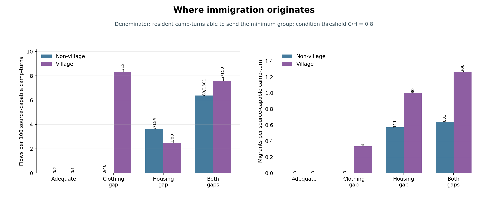

# Unified social relocation validation v0.2

Status: the shared architecture, finite-input accounting, deterministic replay and
population-transfer conservation pass. Native balance, forecast robustness,
learned-policy comparison and promotion of the Physical-v1 social law remain
uncertified. **NO-GO for a fresh MLP training bank.**

## Aggregate game experience first

The sampled game does not look like a demographic death loop. It looks like a
rapidly growing population whose goods economy does not keep clothing and shelter
abreast of growth, while fission repeatedly turns that population into more small
settlements.

Three identical saved post-opening boundaries (seeds 17, 53 and 991) begin with
24 camps and 2,653 people. After 25 continuation turns per seed:

| Social systems | Camps | Population | Fissions | Immigration flows / people | Rapid pair returns |
| --- | ---: | ---: | ---: | ---: | ---: |
| Neither | 24 | 10,716 | 0 | 0 / 0 | 0 |
| Fission only | 150 | 39,063 | 126 | 0 / 0 | 0 |
| Immigration only | 24 | 10,716 | 0 | 0 / 0 | 0 |
| Both | 137 | 36,728 | 113 | 105 / 1,228 | 4 |

No observed daughter or immigration receiver is extinct at the one- or three-turn
follow-up. Gross births and cause-specific deaths are both large, but births remain
larger in aggregate. A genuinely infeasible controlled settlement still declines
for explicit exposure and starvation causes, so this result is not a survival
guarantee.

The end state remains materially poor. Of 137 living tribes, 2 have both clothing
and housing coverage at least 0.8, 5 have only a clothing gap, 28 only a housing
gap, and 102 have both gaps. Total population × QoL is 4,063.899 and
population-weighted QoL is 0.110649. The QoL formula was not changed.


Immigration is not the source of the settlement network. It commits no move in the
immigration-only branch. Fission alone creates 126 new camps; the combined branch
creates 113 because immigration participants sit out same-turn fission and then
change later trajectories. In the combined run, the largest absolute migrant
source is the both-gaps category because it supplies the largest denominator.
Non-village flow counts per source-capable camp-turn are 0/48 for a clothing gap,
7/194 for a housing gap and 83/1,301 for both gaps. Village counts are 1/12,
2/80 and 12/158 respectively. No adequate source sends a cohort. The small
village clothing-only denominator has the highest observed rate, so the evidence
does not support a rule that the composite both-gaps state alone drives movement.



The principal native blocker is therefore fission calibration and daughter/service
viability under the real goods economy, not an immigration-driven death loop and
not a change to experienced QoL. Immigration still needs broader causal coverage,
but its current hysteresis already reduces the few measured reversals.

### Daughter maturation control

The new Physical-v1 daughter cooldown is a narrow timing guard. A matched sweep
from the same three boundaries produced:

| Additional blocked turns | Fissions | Recursive daughter fissions (age 1/2/3/older) | Blocked daughter-camp turns | Camps | Population | Viable settlements | Pop-weighted QoL |
| ---: | ---: | ---: | ---: | ---: | ---: | ---: | ---: |
| 0 | 113 | 61 (3/4/3/51) | 0 | 137 | 36,728 | 2 | 0.111 |
| **1 (shipped)** | **112** | **60 (0/5/3/52)** | **87** | **136** | **36,669** | **2** | **0.110** |
| 2 | 109 | 57 (0/0/5/52) | 177 | 133 | 36,759 | 1 | 0.113 |

The default eliminates one-turn daughter recursion exactly, including across
save/load, but does not materially reduce fragmentation or improve viability. The
two-turn alternative is not promoted: it has only three fewer fissions than the
default and one rather than two viable endpoints. No QoL, mortality, reward,
immigration or fission-threshold calibration changed.

### Forecaster review after the failed balance gate

The requested Astra review found that fission already gives projected food the
first two lexicographic destination keys: capped obtainable support, then uncapped
support, before distance and tile ID. Adding another numerical food or survival
weight would double-count the service and violate the controlled-calibration rule.

The concrete next defect is the new-site food representation. The fission pass
converts capped support back into at most one opening cohort's food, while the
common service forecast funds birth-only person-years (about 1.622 opening cohorts
over 20 years at birth rate 0.045). The new-site capacity also treats all supply as
terrestrial and the non-cultivator branch can apply accessibility a second time.
Thus the forecaster loses productive headroom, can mis-type aquatic food as plant
food, and can cap a stock-free arbitrarily rich site near 0.617 forecast nutrition.
This is a representation defect to isolate before interpreting a food-ranking
sweep. It is pessimistic in general, so correcting it could increase fission and
is not itself presumed beneficial.

## Scope and reproduction

The branch is based directly on reviewed commit
`bcf7f2147fb476b87a976f6c6d4400b5f02ba894`. The tracked contract copy is
byte-identical to the supplied attachment. Representative commands are:

```sh
dotnet build Tools/Headless/Anthropocene.Headless.csproj -c Release
dotnet run --no-build -c Release --project Tools/Headless/Anthropocene.Headless.csproj -- --social-relocation-only
dotnet run --no-build -c Release --project Tools/Headless/Anthropocene.Headless.csproj -- --immigration-only
dotnet run --no-build -c Release --project Tools/Headless/Anthropocene.Headless.csproj -- --fission-only
dotnet run --no-build -c Release --project Tools/Headless/Anthropocene.Headless.csproj -- --social-relocation-native=3
dotnet run --no-build -c Release --project Tools/Headless/Anthropocene.Headless.csproj -- --demography-regression
dotnet run --no-build -c Release --project Tools/Headless/Anthropocene.Headless.csproj -- --demography-social-ablation=25
dotnet run --no-build -c Release --project Tools/Headless/Anthropocene.Headless.csproj -- --demography-immigration-sweep=25
dotnet run --no-build -c Release --project Tools/Headless/Anthropocene.Headless.csproj -- --demography-fission-cooldown-sweep=25
dotnet run --no-build -c Release --project Tools/Headless/Anthropocene.Headless.csproj -- --demography-qol-histogram=25
dotnet run --no-build -c Release --project Tools/Headless/Anthropocene.Headless.csproj -- --social-scale=8,25
dotnet run --no-build -c Release --project Tools/Headless/Anthropocene.Headless.csproj -- --social-scale=80,0
dotnet run --no-build -c Release --project Tools/Headless/Anthropocene.Headless.csproj -- --social-scale=320,0
```

Pipe the histogram rows to `Tools/Headless/Plot-DemographyQoLHistogram.py` to
reproduce both tracked figures.

Focused final counts are 60 shared-relocation, 379 immigration, 655 fission,
37 native matched-continuation and 83 death-spiral assertions. The matched
three-seed ablation passes 17,439 assertions; the ten-row immigration sweep passes
64,403; the three-row daughter-cooldown sweep passes 19,412; the histogram audit
passes 10,175. The final Release rebuild has zero
errors and the two pre-existing unrelated `CS0649` warnings. The full fixed suite
passes in 66.6 seconds with 1,914 MiB peak working set on this host.

## Architecture, finite inputs and compatibility

The focused checks establish:

- the exact mover, source, incumbent and aggregate equations, with physical
  mortality risk separate from forecast experienced QoL and no net-rate sign veto;
- birth-only person-year service ceilings, finite typed food, finite raw material
  stocks/sources, one shared generalist extraction pool and technology-qualified
  specialist extraction;
- source/daughter herd capacity scaled by the retained herd fraction, with a
  zero-herd control and no duplicated provisions, shelter or expectation reset;
- actual workforce-role transfer, opportunity-worker reservation and no worker
  simultaneously producing in an ordinary role and a future opportunity role;
- zero, funded, unfunded, missing-tool, missing-input, filled and wrong-skill test
  providers, one job per worker and canonical declining reservations;
- nonmonotone group-size handling and exact final simultaneous immigration
  revalidation, including a camp that sends frozen residents while receiving a
  different cohort in the same Close pass; endpoint work is pinned by an accepted
  chain, an eight-source fan-in and a cascading rejection with only incident retry;
- neutral-provider parity, scalar/parallel replay, save round trips and exact
  population, inventory, typed-food, herd, workforce and fractional-ledger
  conservation; and
- lazy capacity allocation plus a provably permissive physical fission bound. It
  uses the exact source envelope and optimistic full-service daughter, not
  historical F/C/H/W; `FissionSearchFraction` lowers only the valid upper-bound
  request threshold. Identical physical states with different last-turn
  satisfaction take the same search/decision path, including newly depleted
  settlements.

`ForwardUtility`, `Fission.QoLModel.ForwardAt` and the old largest-remainder legacy
semantics remain the exact decision path for `LegacyQoLNetGrowth`. An absent saved
demographic selector still loads that legacy model. Existing saves that already
select `PhysicalMortalityV1` will use the unified law on this feature branch because
no second serialized social-law selector was introduced. That is an intentional
unmerged behavior change, not backward-decision parity, and must be approved before
promotion.

`Camp.QoL`, its food/water/clothing/housing/expectation/cohesion calculation, the
population-weighted Elder reward and the RL observation schema are unchanged.
Settlement-local and lineage-wide welfare remain separate diagnostics.

## Native same-boundary outcomes

| Variant | Camps | Population | Fissions | Migrations / people | Mean terminal F/C/H | Pop-weighted local QoL |
| --- | ---: | ---: | ---: | ---: | ---: | ---: |
| Neither | 24 → 24 | 2,653 → 10,716 | 0 | 0 / 0 | 0.955 / 0.302 / 0.314 | 0.195 |
| Fission only | 24 → 150 | 2,653 → 39,063 | 126 | 0 / 0 | 0.938 / 0.314 / 0.143 | 0.123 |
| Immigration only | 24 → 24 | 2,653 → 10,716 | 0 | 0 / 0 | 0.955 / 0.302 / 0.314 | 0.195 |
| Both | 24 → 137 | 2,653 → 36,728 | 113 | 105 / 1,228 | 0.947 / 0.286 / 0.111 | 0.111 |

Worst continuous demographic conservation error is `1.71e-13`; every turn also
closes the integer population and gross birth/death ledgers. Twenty-one accepted
immigration destinations have higher forecast QoL and worse forecast mortality
when destination X1 is compared with the mover's source X0 on both axes,
confirming that mortality is visible without becoming a categorical veto.

The follow-up diagnostics remain cautionary rather than causal proof. Of 113
daughters, 107 are observed at age one and 101 at age three, with no extinction;
the age-three survivors average `-0.208` QoL and `-0.263` clothing coverage
relative to their event boundary. Of 105 receivers, 98 are observed at age one and
88 at age three, with no extinction; the age-three survivors average `-0.115` QoL,
`-0.165` clothing coverage and `+23.112` deficit years. No daughter or receiver is
fully healthy at the recorded event boundary or age three. Growth, subsequent
shocks and further transfers confound those raw deltas, so they justify targeted
matched tests rather than a claim that immigration caused the decline.

## Accepted, suppressed and forced continuation

The causal harness finds a real seed-17 boundary after two ordinary preparation
turns and isolates a 7-person immigration from camp 59 to camp 19. The accepted
flow records mover/source/incumbent/aggregate changes of
`+0.200813 / +0.002866 / -0.000822 / +0.006067`, destination forecast QoL 0.180,
F/C/H `0.363 / 0.000 / 1.000`, mortality risk 0.427 and stability zero.

An independently forced transfer has the same endpoint workforce, inventory,
typed food, demographic ledgers, migration memory and contact chronology as the
accepted branch. After three real heuristic/economy/ecology/demography turns,
accepted and forced transfer states remain identical. The sum across the three
follow-up endpoints of world `population × QoL`, accepted minus suppressed, is
`+0.957888`. This is explicitly an endpoint-welfare proxy, not the contract's
integrated person-year welfare. Age zero is reported only as a boundary proxy and
is excluded from that sum.
This case supports the transaction implementation; it does not certify all
receivers or fission daughters.

The 20%, 40% and delayed-40% branches are explicitly compound external shocks to
production, local stocks/ecology, capital, housing and herds on unique affected
tiles. They run the real economy with no correction resources. They are not a
claim that the forecast itself missed each input by exactly 20% or 40%, and they do
not yet provide a conservative admission rescore. Broader positive- and
zero-stability immigration cases plus matched fission cases remain required.

## Hysteresis calibration sweep

The ten-row matched sweep leaves the QoL function, physical demography and fission
coefficients unchanged. With hysteresis disabled, 102 flows move 1,217 people and
produce eight rapid pair returns. The current three-turn/0.10 penalty has 105
flows, 1,228 people and four returns. Raising only the penalty to 0.20 yields 103
flows, 1,240 people and one return; 0.25 and 0.30 are identical in this sample. A
five-turn/0.20 row also has 103/1,240/one.

Thus the existing hysteresis mitigates oscillation, and 0.20 has a measured pair-
return benefit. It is still not promoted: one one-turn return remains, age-three
receiver QoL is essentially unchanged (`-0.115` versus `-0.114`), and the sweep
does not establish causal receiver-welfare improvement or held-out stability. No
immigration threshold, cap, cooldown or penalty changed. Arrival population
remains a Close-boundary transfer and first enters the real economy/demographic
calculation on the following turn.

## Recoverable distress and death-spiral gates

The physical-demography regression remains green:

- temporary clothing/housing loss and temporary food loss resume positive growth
  after service restoration;
- repeated infeasible loss declines for attributable exposure and starvation;
- deaths, emigration and fission reconcile separately, with social events conserved
  as transfers rather than mortality; and
- the native Elder rebuilds specialist assignments and real clothing/housing from
  remaining people, tools and finite raw resources, reaching three sustained
  served turns with first sustained recovery at turn 8.

There are no population floors, free resources, automatic manufacturing or
demographic bonuses. A learned-Elder runtime/model artifact is not present, so a
matched native-versus-learned shock comparison remains unavailable.

## Performance versus the pinned commit

`SocialScaleBenchmark` is the same source compiled at the pinned commit and on
this branch. It measures the actual AI/prepare/resolve path in Release with seed
1729 and four workers. Short runs include JIT and host noise, and fission causes
the branches to diverge in camp count; these are scale observations, not a
cycle-exact microbenchmark.

| Scale | Pinned turn p50/p95 ms | Unified turn p50/p95 ms | Pinned alloc p50/p95 MiB | Unified alloc p50/p95 MiB | Unified social p50/p95 ms |
| --- | ---: | ---: | ---: | ---: | ---: |
| 8 starts, opening | 36.1 / 279.3 | 66.7 / 230.7 | 3.06 / 6.41 | 4.52 / 7.58 | 11.2 / 46.8 |
| 80 starts, opening | 431.6 / 500.8 | 615.5 / 997.0 | 63.99 / 102.02 | 77.16 / 120.54 | 103.7 / 157.6 |
| 320 starts, opening | 1,066.3 / 1,208.8 | 1,271.1 / 2,176.4 | 265.38 / 433.54 | 313.03 / 496.86 | 121.5 / 284.5 |
| 8 starts + 25 turns | 175.4 / 295.3 | 187.4 / 454.1 | 18.98 / 50.52 | 21.85 / 54.49 | 74.4 / 216.5 |

The safe fission bound deliberately builds physical baselines instead of using
historical coverage. The 320 run records 4,710 forecasts, 3,405 capacity builds
and 2,503 hits; its only active joint-immigration turn uses one batch, two flow
evaluations and eight endpoint builds. The mature run records 5,971 forecasts,
1,208 builds and 9,604 hits (0.888 hit share), with 34 flow evaluations and 135
endpoint builds across 20 joint batches. No dependency retry occurs in those
low-flow samples; the focused chain/fan-in/cascade tests exercise it directly.

Whole-turn 320 p95 is 80% above the pinned sample and allocation p95 is 14.6%
higher. The behaviorally divergent mature run ends with 40 rather than 88 camps
but still has a 54% higher p95. The 80 sample has a 99% higher p95, and
these short samples are not warmed repeated-boundary certification. They are
sufficient to fail, not pass, the throughput gate. The local scaling defect found
in review is fixed, but performance is **NO-GO for MLP throughput**. The next
optimization target is forecast-view/material-summary allocation and safe baseline
reuse, not a return to historical QoL coverage.

## GO/NO-GO matrix

| Gate | Result | Evidence / remaining work |
| --- | --- | --- |
| Conservation and legacy compatibility | PASS / scoped | Exact physical transfers and legacy selector path pass; existing Physical-v1 saves deliberately adopt the feature law |
| QoL and RL objective preservation | PASS | QoL calculation, reward and observation schema unchanged; local and lineage welfare separate |
| Shared physical architecture | PASS | One evaluator for immigration/crowding/distress; finite service/material inputs; no mortality-from-QoL or net-rate veto |
| Future opportunity accountability | PASS in injected fixtures | Neutral parity plus funded/false/filled/wrong-skill/reservation/nonmonotone coverage; no live jobs |
| Native conservation and recoverable distress | PASS | Same-boundary conservation, cause ledgers and endogenous rebuild pass |
| Healthy/saturated/distress social balance | NO-GO | The cooldown removes age-one recursion but changes 113 to only 112 combined fissions; terminal protection remains poor; prepared matched fission cases are incomplete |
| Native causal cases | PARTIAL | One immigration accepted/suppressed/forced case is positive and exact; fission and broader receiver classes missing |
| Forecast robustness | NO-GO | New-site food is capped before the service envelope, loses aquatic type and can receive a second accessibility discount; stability is diagnostic only; compound shocks are not lower-bound admission rescores |
| Oscillation | PASS for current default; calibration open | Existing hysteresis cuts rapid returns 8→4; 0.20 cuts them to one but lacks causal/held-out welfare justification |
| Performance | NO-GO for MLP | Endpoint-local reconciliation passes work-counter tests, but 320/mature p95 and allocation overhead fail promotion |
| Learned-vs-native comparison | NOT AVAILABLE | No learned policy artifact/runtime; RL observation/action/training defects remain separate |

## Decision and concrete next steps

**NO-GO for creating a fresh MLP training bank. Do not merge or start training.**

The shortest evidence-driven route to GO is:

1. Correct the daughter food-envelope representation without changing utility or
   thresholds: preserve uncapped repeatable land/aquatic supply separately, apply
   actual transferred workforce and accessibility once, and expose uncapped
   renewable-food and typed-production diagnostics. Lock rich-site headroom,
   aquatic non-fungibility, workforce, conservation and deterministic parity in
   focused tests.
2. Only after that correction, build matched healthy, productively saturated and
   physically distressed fission fixtures on saved native boundaries, then sweep only the existing policy
   thresholds/search fraction. The search fraction may affect only the proven
   upper-bound request, never become a separate acceptance condition. The objective
   is to retain viable saturated and distress splits while reducing repeated
   fragmentation; add no survival bonus or QoL-ratio shortcut.
3. Compare the current one-site cache with a bounded candidate shortlist. Every
   shortlisted destination must pass the unchanged common evaluator; among accepted
   sites compare current ordering against uncapped renewable food, mover utility,
   aggregate welfare, distance and ID. Measure shortlist misses and cache behavior;
   do not add a numerical food bonus.
4. Add a conservative/lower-bound version of the same service envelope and test it
   against positive- and zero-stability accepted immigration and fission cases,
   including delayed finite-input exhaustion. Keep `Stability` diagnostic until
   those causal results justify how it enters the existing four comparisons.
5. Extend accepted/suppressed/forced native continuations to fission daughters and
   more receiver classes for at least three turns, reporting production, F/C/H,
   cause deaths, workforce, population × QoL and integrated person-year welfare;
   keep endpoint sums explicitly labelled as proxies.
6. Reduce forecast-view/material-summary allocation and safe-baseline cost, then
   run warmed repeated identical-boundary 80/320/mature benchmarks plus dense-flow
   rejection cascades. Preserve endpoint-local reconciliation and exact canonical
   results.
7. Rerun the 2×2 ablation, calibration sweep, histograms, full fixed/save-replay
   suite and then the requested native-versus-learned shocks once a learned policy
   runtime exists. Resolve RL observation/action/training defects independently.
